<div align="center">


Inspired by the [Demon's Shot](https://www.youtube.com/watch?v=OWDcn7hl16A) music video.

<br>

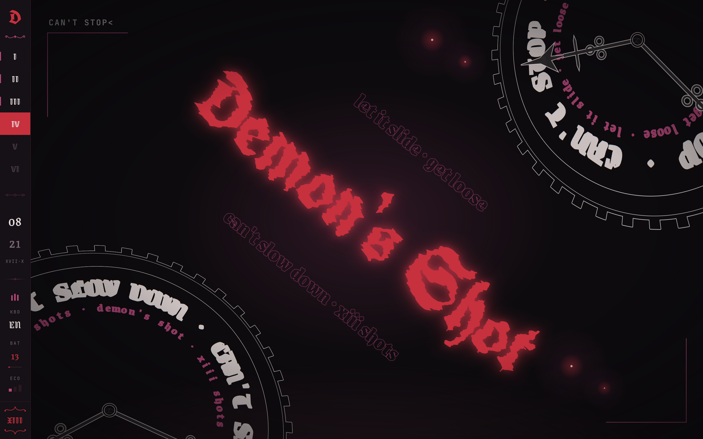

</div>

<div align="center"></div>

<h2 align="center">What's inside</h2>

| | | |
|---|---|:---:|
| **Bar** | workspaces, clock, volume, CPU, memory, battery, power | |
| **Wallpaper** | animated wallpaper | |
| **Altar** | dashboard: media, performance, weather | `Super` `Space` |
| **Launcher** | apps, commands, windows | `Super` |
| **Book** | settings | `Super` `I` |
| **Shot** | screenshots, recording | `Print` |
| **Clip** | clipboard history | `Super` `V` |
| **Ward** | quick toggles in the corner | `Super` `N` |
| **Pact** | Clash Verge panel | `Super` `P` |
| **Charms** | kaomoji, emoji, ascii art, symbols, stickers | `Super` `.` |
| **Power** | power menu | `Super` `Esc` |
| **Lock** | lock screen | `Super` `L` |
| | notifications, volume and brightness OSD | |

Also: Hyprland (Lua), hypridle, kitty, fish, starship, fastfetch, btop, cava, GTK.

<div align="center"></div>

<h2 align="center">Screenshots</h2>

| | |
|:---:|:---:|
| 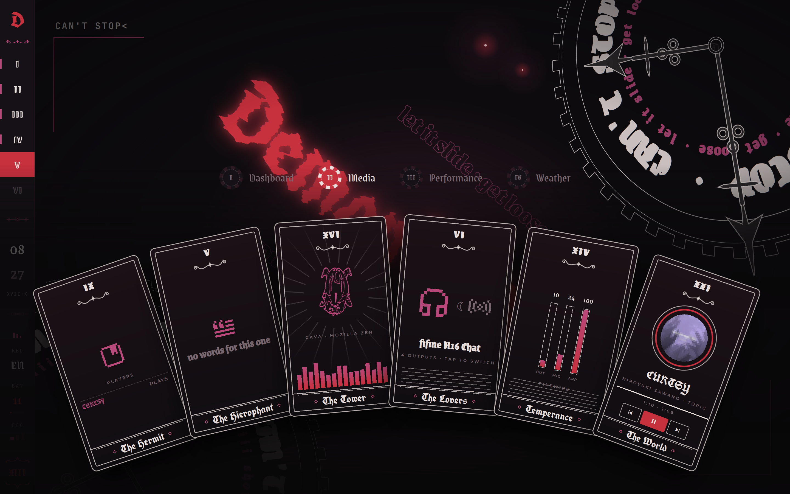 **Altar** | 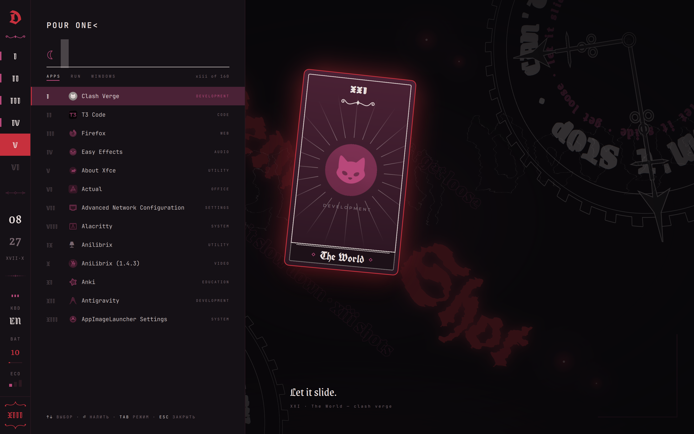 **Launcher** |
| 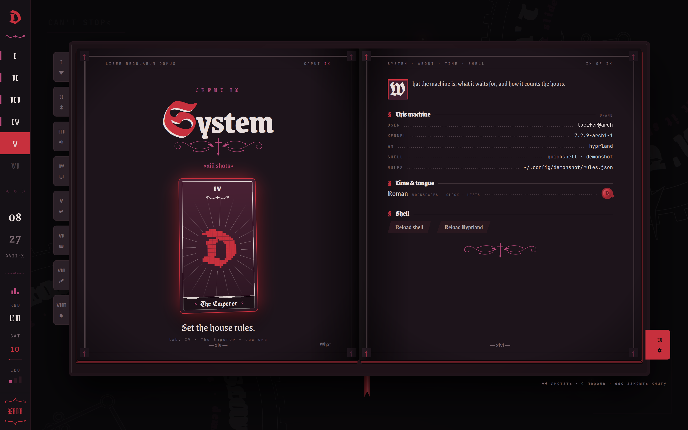 **Settings** | 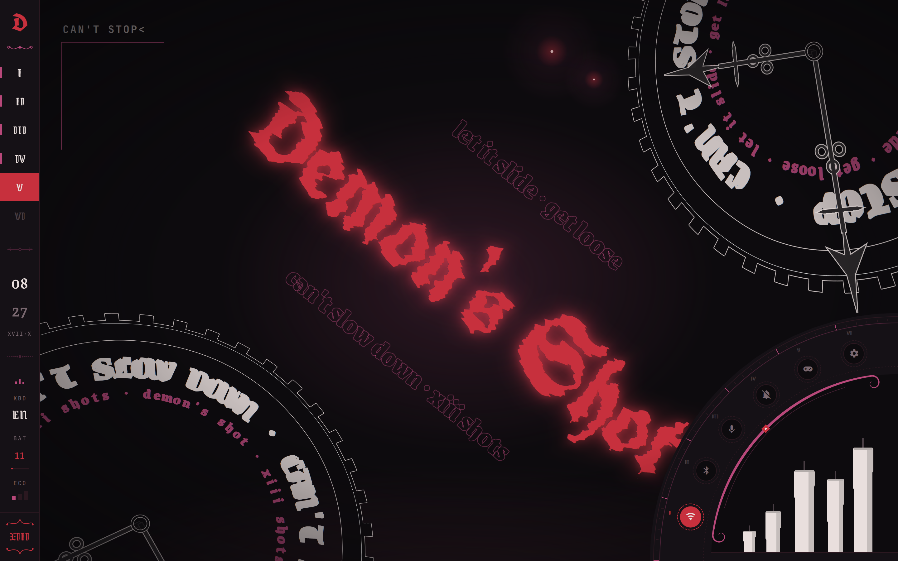 **Ward** |
| 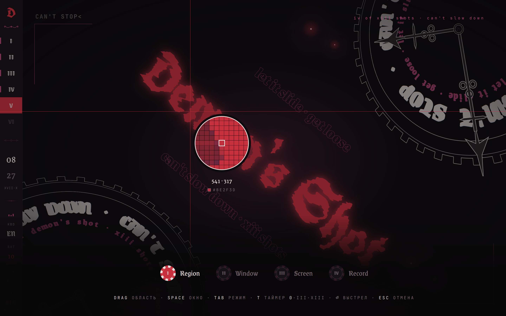 **Shot** | 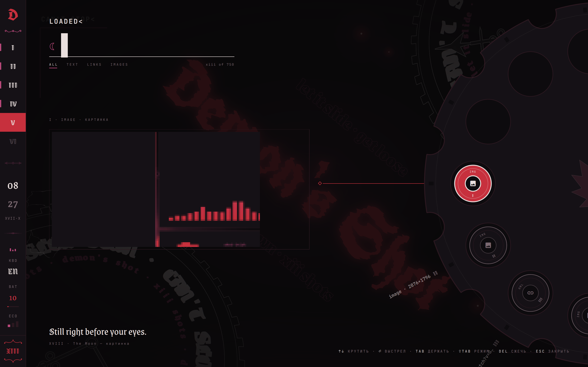 **Clip** |
| 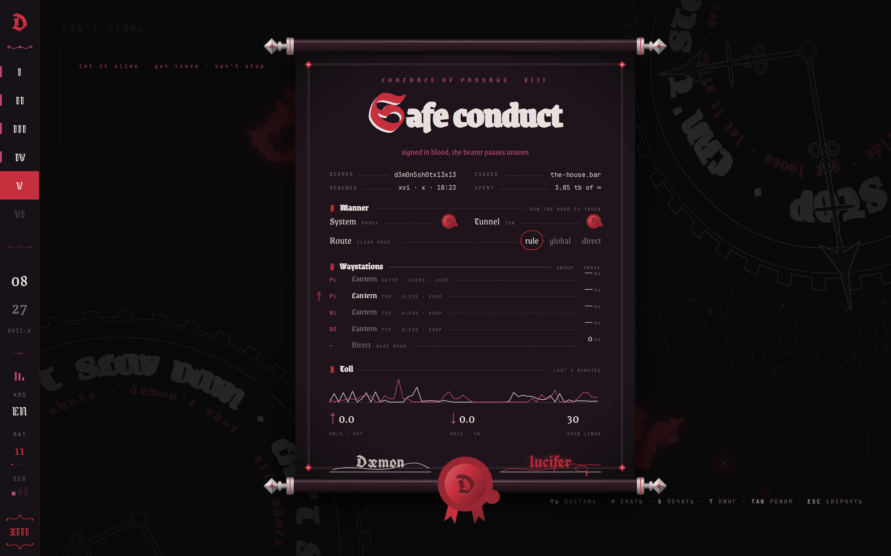 **Pact** | 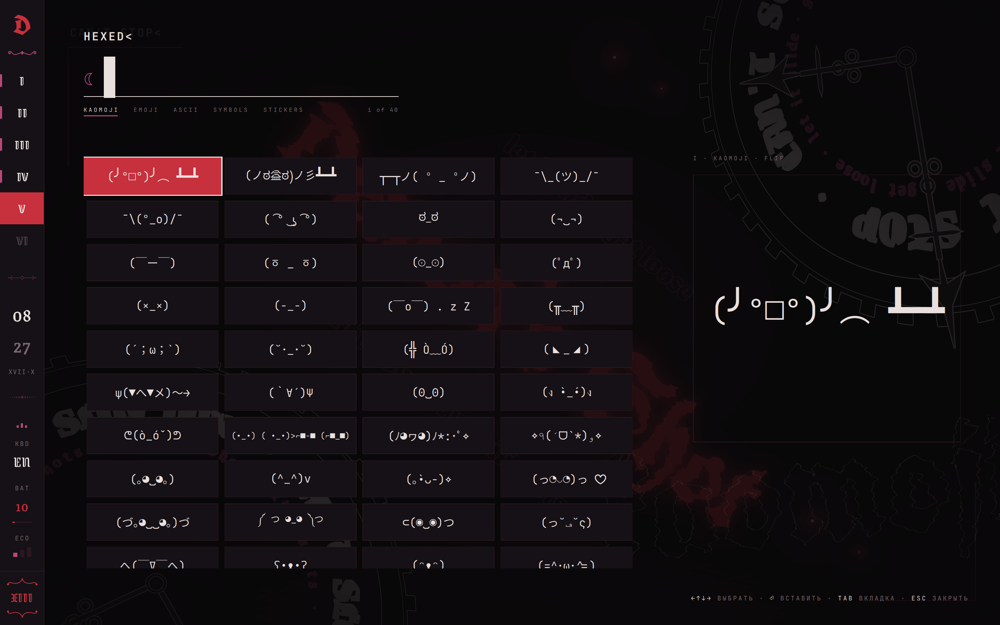 **Charms** |
| 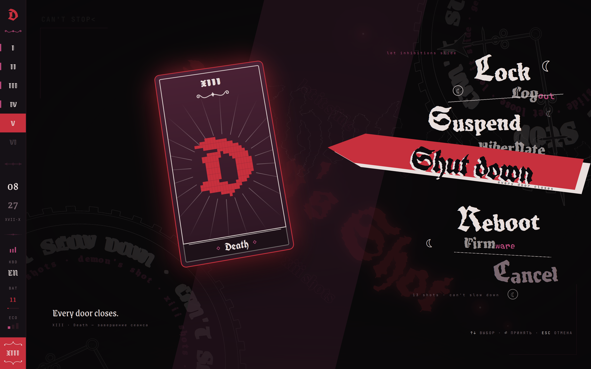 **Power** | |

<div align="center"></div>

<h2 align="center">Install</h2>

```sh
git clone https://github.com/Nebelung-cloud/demons-shot-rice ~/.local/share/demons-shot
~/.local/share/demons-shot/install.sh          # Arch: packages, services, symlinks
~/.local/share/demons-shot/install.sh --links  # any distro: symlinks only
```

Old configs go to `~/.dots-backup-<date>/`.

| `config/` | goes to |
|---|---|
| `hypr/` | `~/.config/hypr` |
| `quickshell/demonshot/` | `~/.config/quickshell/demonshot` |
| `kitty/` `btop/` `cava/` `fastfetch/` `qtengine/` `starship.toml` | `~/.config/…` |
| `gtk-3.0/gtk.css` `gtk-4.0/gtk.css` | `~/.config/gtk-*/gtk.css` |
| `fish/` | `~/.config/fish` |
| `fonts/` `fontconfig/` | `~/.local/share/fonts/demonshot`, Cyrillic falls back to Monomakh |

Monitor, backlight, GPU and sensors are detected. Keyboard layouts are in `hypr/hyprland/input.lua`,
default apps in `hypr/variables.lua`.

<div align="center"></div>

<h2 align="center">Dependencies</h2>

| | |
|---|---|
| **Shell** | `quickshell` · `hyprland` 0.56+ · `hypridle` · `hyprsunset` · `xdg-desktop-portal-hyprland` · `jq` · `curl` |
| **System** | `networkmanager` · `bluez` · `pipewire` · `wireplumber` · `upower` · `brightnessctl` · `libnotify` · `playerctl` · `polkit-gnome` · `gnome-keyring` · `geoclue` |
| **Capture** | `grim` · `slurp` · `imagemagick` · `gpu-screen-recorder` · `cliphist` · `wl-clipboard` · `wtype` |
| **Terminal** | `kitty` · `fish` · `starship` · `fastfetch` · `btop` · `cava` · `eza` · `zoxide` · `direnv` |
| **Look** | `papirus-icon-theme` · JetBrains Mono Nerd Font · Bibata · `qtengine` · `darkly` |
| **Optional** | `clash-verge-rev` · `nvidia-utils` · `ydotool` · `hyprpicker` · `swappy` · `trash-cli` |

From the AUR only `qtengine`, `darkly`, Bibata, Zen and Clash Verge, all optional. Pact expects Clash Verge in English.
NixOS: change the `/usr/lib` agent paths in `hypr/hyprland/execs.lua`.

<div align="center"></div>

<h2 align="center">Colours</h2>

<div align="center">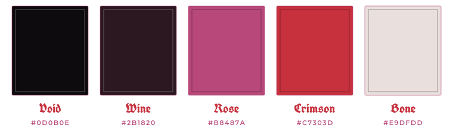</div>

<br>

Six more palettes in settings (Absinthe, Nightshade, Holy Water, Rust, Gilded, Ghost), they recolour Hyprland, kitty, GTK, btop and cava.

Fonts: Grenze Gotisch, UnifrakturCook, Monomakh, Montserrat, JetBrains Mono.

<div align="center"></div>

<h2 align="center">Inspiration</h2>

- [**Aiobahn +81 – Demon's Shot (feat. DEMONDICE)**](https://www.youtube.com/watch?v=OWDcn7hl16A): the look, frames in `ref/`.
- [**Caelestia**](https://github.com/caelestia-dots/shell): the shell I used before; corner toggles and hardware detection follow it.

<div align="center"></div>

<h2 align="center">License</h2>

[GPL-3.0](LICENSE). Fonts in `config/fonts/` are under the [SIL Open Font License](config/fonts/OFL.txt);
the cava shaders keep their own MIT headers. The song, its artwork and the video frames in `ref/`
belong to Aiobahn, DEMONDICE and their label.

<div align="center"></div>

<div align="center">

```
/ᐠ˵- ᴗ -˵マ ᶻ 𝗓 𐰁
```

```
⠀⠀⠀⠀⠀⠀⠀⠀⠀⠀⠀⠀⠀⠀⠀⠀⠀⠀⠀⠀⠀⠀⠀⠀⠀⠀⣀⡀⠀⠀⠀⠀⠀⠄⠀⠀⠀⠀⠀⠀⠀⠀⠀⠀⠀⠀⠀⠀⠀⠀
⠀⠀⠀⠀⠀⠀⠀⠀⠀⠀⠀⠀⠀⠀⠀⠀⠀⠀⠀⠀⠀⠀⠀⠀⠀⠘⡿⠇⠀⠀⠀⠀⢻⡄⠀⠀⠀⠀⠀⠀⠀⠀⠀⠀⠀⠀⠀⠀⠀⠀
⠀⠀⠀⠀⠀⠀⠀⠀⠀⠀⠀⠀⠀⠀⠀⠀⠀⠀⠀⠀⠀⠀⠀⠀⠀⢀⡇⠀⠀⠀⠀⡸⣞⡇⠀⠀⠀⠀⠀⠀⠀⠀⠀⠀⠀⠀⠀⠀⠀⠀
⠀⠀⠀⠀⠀⠀⠀⠀⠀⠀⠀⠀⠀⠀⠀⠀⠀⠀⠀⠀⠀⠀⠀⠀⠀⢸⠃⠀⠀⠀⢀⣧⢿⣽⡀⠀⠀⠀⠀⠀⠀⠀⠀⠀⠀⠀⠀⠀⠀⠀
⠀⠀⠀⠀⠀⠀⠀⠀⠀⢴⣿⠆⠀⠀⠀⠀⠀⠀⠀⠀⠀⠀⠀⠀⠀⢸⠀⠀⠀⠀⣼⣞⡿⣞⡅⠀⠀⠀⠀⠀⠀⠀⠀⠀⠀⠀⠀⠀⠀⠀
⠀⠀⠀⠀⠀⠀⠀⠀⠀⠀⠈⠓⢤⡀⠀⠀⠀⠀⠀⠀⠀⠀⠀⠀⠀⣾⠀⠀⠀⣰⣟⢾⣽⢫⡿⠀⠀⠀⠀⠀⠀⠀⠀⠀⠀⠀⠀⠀⠀⠀
⠀⠀⠀⠀⠀⠀⠀⠀⠀⠀⠀⠀⠀⠙⢦⡀⠀⠀⠀⠀⠀⠀⠀⠀⠀⣿⣠⢤⣶⡻⣞⣿⣺⢯⣽⣳⡀⠀⠀⠀⠀⠀⠀⠀⠀⠀⠀⠀⠀⠀
⠀⠀⠀⠀⠀⠀⠀⠀⢠⣄⡀⠀⠀⠀⠀⠙⢦⡀⠀⠀⠀⠀⣀⣠⣤⣿⣽⣻⢾⣽⣷⣾⣽⣻⣞⣷⣳⡄⠀⠀⠀⠀⠀⠀⠀⠀⠀⠀⠀⠀
⠀⠀⠀⠀⠀⠀⠀⠀⠈⢻⣿⣶⣄⡀⠀⠀⠀⣉⣲⣴⢶⣞⡿⣽⣞⡷⣯⢿⡽⣞⣿⠟⠋⠁⠉⠈⠳⣟⣆⠀⠀⠀⠀⠀⠀⠀⠀⠀⠀⠀
⠀⠀⠀⠀⠀⠀⠀⠀⠀⠀⢻⣿⣿⣿⣿⢶⣾⣿⡽⣯⣟⡾⣽⡷⣯⣟⡽⡾⣽⡯⠁⠀⠀⠀⠀⠀⠀⢮⣭⣦⡀⠀⠀⠀⠀⠀⠀⠀⠀⠀
⠀⠀⠀⠀⠀⠀⠀⠀⠀⠀⠉⢞⣿⣿⢯⡿⣿⣯⣟⣷⣯⢿⣳⣟⡷⣽⣼⣻⣽⠀⠀⠀⠀⠀⠀⠀⢀⣼⡯⡗⠋⠤⠀⠀⠀⠀⠀⠀⠀⠀
⠀⠀⠀⠀⠀⠀⠀⠀⠀⠀⠀⢾⣿⣿⣯⣽⣾⣿⣾⣗⡿⣯⡷⣯⣟⡷⣞⣼⣿⣀⠀⠀⠀⠀⢀⣠⡿⣏⡗⠈⠐⠈⠅⠀⠀⠀⠀⠀⠀⠀
⠀⠀⠀⠀⠀⠀⠀⠀⠀⠀⢀⣼⠛⠏⠉⠉⠽⢟⢿⣿⣿⣿⣿⣷⣻⢾⡽⣞⡷⠄⡹⣶⢿⣻⢿⣻⡽⢯⣼⢦⠶⠁⠈⠀⠀⠀⠀⠀⠀⠀
⠀⠀⠀⠀⠀⠀⠀⠀⠀⠀⣸⣯⠇⠀⠀⠀⠀⠀⠁⣽⣿⣿⣿⣷⣯⣿⣽⣛⡦⠀⠀⢩⣿⣹⢯⣷⢻⣟⠺⢣⡖⣘⠤⠓⠀⠀⠀⠀⠀⠀
⠀⠀⠀⠀⠀⠀⠀⠀⠀⠀⢈⣿⡃⠁⠀⠀⠀⢀⣤⣾⣟⢿⣻⣿⣿⣟⡾⣽⡳⠄⠎⢳⣯⢯⣟⡾⢯⣞⣯⣓⠉⢀⠀⠀⡄⢢⡀⠀⠀⠀
⠀⠀⠀⠀⠀⠀⠀⠀⠀⠀⣸⣷⣷⣶⣳⣶⣺⣿⣿⣳⢯⣟⣿⣿⣳⢯⠛⠅⠃⠀⠀⣴⣿⡿⣬⢶⠾⠙⣊⣥⠾⡒⠊⢁⢠⠣⣌⠀⠀⠀
⠀⠀⠀⠀⠀⠀⠀⠀⠀⠀⢺⡽⣾⡽⣯⣟⣿⡿⣯⣿⣿⣾⢿⣿⠳⢏⣈⢠⠀⠀⣰⢿⡿⣽⣉⡶⠌⠋⠉⣀⡀⠁⠀⠀⠀⣘⡐⣂⠀⠀
⠀⠀⠀⠀⠀⠀⠀⠀⠀⠀⠘⣽⣳⣟⣳⣟⣾⣽⣿⣿⣿⣿⣿⣦⣜⡻⡽⠆⠧⣴⡟⣯⢟⡳⣭⠲⠄⠐⠀⠀⠀⠈⠁⠉⠑⢊⡕⢃⠄⠀
⠀⠀⠀⠀⠀⠀⠀⠀⠀⠀⠀⠹⣿⣾⣿⣯⣿⣾⣿⣿⣿⣿⣿⣿⣿⣿⣾⢧⠀⠹⠾⡵⡞⡽⢢⣃⠐⠀⠀⠄⡐⠀⠀⠀⡘⢦⠘⣌⠀⠀
⠀⠀⠀⠀⠀⠀⠀⠀⠀⠀⠀⠐⠹⢿⣿⣿⣿⣿⣿⣿⣿⣿⣿⣿⣿⣿⢯⡏⠀⠀⠀⠀⠀⠀⠀⠀⠀⠀⣀⠒⡈⠀⡀⠄⡑⠢⣉⠴⣈⣆
⠀⠀⠀⠀⠀⠀⠀⠀⠀⠀⠀⠀⠀⣀⠻⣿⣿⣿⣿⣿⣿⣿⣿⣿⣿⢯⣏⡴⣶⣵⣢⢤⢠⡀⡄⢠⠐⡰⢌⡱⠀⡁⡀⠆⡥⠆⡥⣛⡽⣾
⠀⠀⠀⠀⠀⠀⠀⠀⠀⠀⡀⠔⠉⠀⠀⢽⣿⣿⣿⣿⣿⣿⣿⣿⣿⣿⣼⣻⢷⣯⡽⣞⣷⣻⡼⣡⢋⡔⠣⠜⡐⢐⠠⡓⣤⣙⣲⣽⣻⢷
⠀⠀⠀⠀⠀⠀⠀⠀⠀⠀⠀⠀⠀⠀⠀⠘⢿⣿⣿⣿⣿⣿⣿⣿⣿⣿⣿⣿⣿⣷⡿⣽⣞⣷⣻⡴⣣⢜⡱⣊⡕⣊⠠⡙⡰⣭⢷⣯⣿⢿
```

</div>
